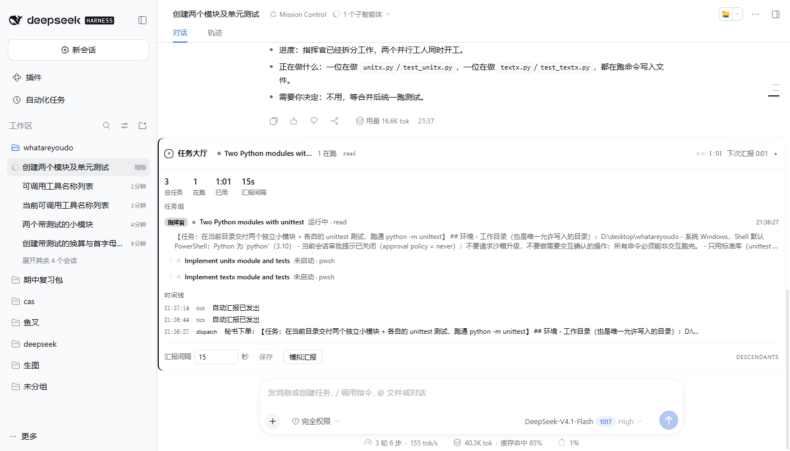
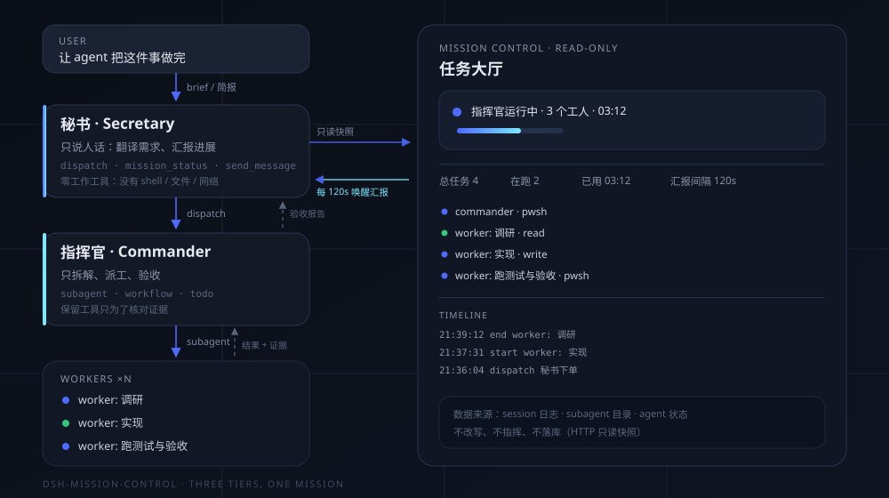

# dsh-mission-control

<p align="center">
  
</p>

<p align="center">
  <b>Your agent shouldn't do the talking and the work.</b><br />
  A secretary that only talks. A commander that only orchestrates. Workers that ship.<br />
  A live mission board above the composer, and a progress brief every two minutes.
</p>

<p align="center">
  <a href="README.zh.md">中文</a> ·
  <a href="#install">Install</a> ·
  <a href="#how-it-works">How it works</a> ·
  <a href="#configuration">Configuration</a> ·
  <a href="#design-notes">Design notes</a>
</p>



<p align="center"><sub>A real mission: the board shows the commander, two parallel workers, the elapsed time and two automatic briefs in the timeline.</sub></p>

---

## The problem

A single agent that talks to you is also the agent that codes. On any task longer
than a few minutes that breaks in three predictable ways:

1. **It goes silent.** Ten minutes of tool calls, and you have no idea whether it
   is working, stuck, or off in the wrong direction.
2. **It loses the plot.** Context fills with tool output, and the thing you asked
   for turns into the thing it happened to be doing.
3. **Nobody verifies.** The agent that wrote the code is the agent that declares it
   done.

`dsh-mission-control` fixes this by splitting the job into three roles that cannot
silently collapse into one another.

## What you get

- **A secretary** you talk to. It never runs a command, opens a file, or searches
  the web. It turns your request into a self-contained brief, hands it to the
  commander, and reports back in plain language.
- **A commander** that only decomposes, delegates, and verifies. It keeps the work
  tools so it can check evidence — but its prompt forbids implementing the work.
- **Workers** that each do one scoped job and return a verifiable result. A worker
  cannot spawn more workers, so the tree stays flat and bounded.
- **A live mission board** in the composer: commander status, every worker, the
  current tool each one is in, elapsed time, the timeline, and the report cadence.
- **A progress brief every 2 minutes** (configurable, 15 s – 1 h). The secretary is
  woken with a `[[MISSION_TICK]]` message, reads the board *read-only*, and answers
  in at most four lines. If nothing changed, it says so in one line.

## Install

Requires DeepSeek Harness with the `desktop` (or any Web) profile.

### From GitHub

```bash
dsh plugin --profile desktop add "github:fuxiaoji/dsh-mission-control"
```

### From a local checkout

```bash
git clone https://github.com/fuxiaoji/dsh-mission-control
dsh plugin --profile desktop add "link:/absolute/path/to/dsh-mission-control"
```

### Or from inside the harness

Use the `plugin_manager` tool (or **Settings → Plugins → Install bundle**) with the
absolute directory of this repository.

After installing:

1. **Refresh the Web page** once, so the client bundle is loaded.
2. **Start a new session** and pick the **Mission Control** preset.
3. Say what you want done.

> The `Commander` and `Worker` presets also appear in the picker. They are internal
> roles: the secretary and the commander start them for you. You should never pick
> them for a normal session.

## Use

Talk to the secretary the way you talk to a capable chief of staff:

```
Build a CLI that turns a folder of Markdown into a static site.
Requirements: incremental builds, a watch mode, tests.
Acceptance: `npm test` green and a working demo in examples/.
```

The secretary restates goal / deliverables / acceptance criteria, calls `dispatch`
with a self-contained brief, and tells you reporting has started. From there:

- The **board** tells you what is happening right now.
- Every **2 minutes** the secretary posts a four-line brief.
- If you change your mind, tell the secretary — it relays the correction to the
  commander with `send_message` instead of starting over.
- When the mission ends, the secretary gives you an **acceptance checklist**:
  what was built, where it lives, how to verify it, what risks remain.

Useful things to say:

| You say | What happens |
|---|---|
| “现在到哪一步了？” | Secretary calls `mission_status`, answers from the board. |
| “先别写代码，给我方案” | Brief changes; commander is told to stop at a plan. |
| “把汇报改成 5 分钟” | Report interval is saved and re-armed immediately. |
| “这个 worker 跑偏了” | Secretary messages the commander, who re-scopes that worker. |

## How it works



### The three presets

| Preset | Id | Who starts it | Tools | Job |
|---|---|---|---|---|
| **Mission Control** | `orchestrator` | You | `dispatch`, `mission_status`, `send_message`, `list_agents`, `ask_user_question`, `present` | Translate, report, relay. Never work. |
| **Commander** | `commander` | The secretary's `dispatch` | shell, files, search, web, todo, `subagent`, `workflow` | Decompose, delegate, verify, summarize. |
| **Worker** | `worker` | The commander's `subagent` | shell, files, search, web, todo | One scoped job, one verifiable result. |

A preset is a complete capability boundary in DeepSeek Harness, so “the secretary
never works” is not a prompt request — the tools do not exist in that session.

### The flow

```
user ──▶ secretary ──dispatch(brief)──▶ commander ──subagent──▶ workers
              ▲                            │                      │
              │                            └────── results ───────┘
              │                                    (verify)
              └──────── acceptance report ─────────┘
```

1. The secretary composes a brief (goal, deliverables, acceptance criteria,
   constraints, what *not* to touch) and calls `dispatch`.
2. `dispatch` is a stock `dsh-tool-subagent` instance pinned to the `commander`
   preset. The child starts in the background; the tool returns immediately, so the
   secretary is free to keep talking to you.
3. The commander writes a todo plan and starts workers — several at once when the
   work is independent.
4. Workers return results. The commander checks the evidence (files, diffs, test
   output) and re-delegates anything that does not meet the bar.
5. The commander sends a structured summary; the secretary turns it into an
   acceptance checklist for you.
6. Meanwhile the Host plugin wakes the secretary every N seconds with a read-only
   status snapshot. No work, no tool side effects — a status read and four lines.

### What is actually installed

| Piece | File | Role |
|---|---|---|
| Host plugin | `index.js` | Mission registry, `mission_status` tool, report ticker, `/dsh-mission/api/*` read-only routes. |
| Client plugin | `client.js` | The mission board in `conversation.input.dock`. Polls the snapshot route every 2.5 s. |
| Presets | `cordis.patch.yml` | Declares `orchestrator`, `commander`, `worker`. |
| Pure helpers | `lib/pure.js` | Config normalization, tree shaping — unit-tested without a Harness. |

The Host plugin deliberately contains **no agent-spawning code**. Child creation,
depth limits, cancellation, cleanup and permissions stay with DeepSeek Harness; the
plugin observes the `subagent` catalog and reports it.

## Configuration

All options live on the plugin row, so they survive upgrades in your profile patch.

```yaml
- id: mission-control
  name: dsh-mission-control
  config:
    reportIntervalSec: 120     # 15–3600; how often the secretary reports
    secretaryPresets: [orchestrator]
    commanderPresets: [commander]
    denyCommanderWrites: true  # block write/edit for commanders
    dispatchToolName: dispatch
    idleStopMinutes: 20        # stop reporting when the whole tree is idle
    maxEvents: 40              # timeline entries kept per mission
    minTickGapSec: 30          # do not stack ticks
```

Edit them in `$DSH_HOME/profiles/<profile>/cordis.patch.yml`, or change the interval
live from the board’s footer (it is persisted to
`$DSH_HOME/mission-control/state.json`).

To put a stronger model behind the commander, give the `dispatch` row its own route:

```yaml
- id: dispatch
  name: '@deepseek-ai/dsh-tool-subagent'
  config:
    provider: spawn
    toolName: dispatch
    agentPreset: commander
    maxDepth: 3
    agentOptions:
      provider: deepseek-official
      model: deepseek-reasoner
```

## Design notes

**Why the secretary has no work tools.** Prompt-level “don't do the work” fails the
first time a task looks like a one-liner. Removing the tools is enforceable, visible
in the schema, and survives context compaction. The secretary physically cannot
`bash`.

**Why the commander keeps tools.** Verification needs evidence: read the diff, run
the tests, check the file exists. The commander is allowed to *inspect*, and the
Host plugin installs a tool guard that **denies `write` and `edit`** for every
commander — the prompt says “delegate”, the guard makes it true. Shell stays
available because running tests is verification.

**Why workers cannot delegate.** Unbounded recursion is how a $2 task becomes a $40
task. Workers get one job and no `subagent` tool. The commander owns fan-out.

**Why the tick is a `followup`, not an `inject`.** `inject` does not wake an idle
agent, so reports would only appear when you happened to send something. `followup`
wakes the secretary; the plugin skips the tick while the secretary is already running
and stops entirely once the whole tree has been idle for a minute.

**Why the board reads the session catalog.** Mission state is derived from the
`subagent` catalog and live agent status — not from a parallel database. That means a
page reload, a restarted Harness, or a cold session still renders the real tree.

## Permissions and cost

- **Permissions.** In-process children inherit the permission scope of the session
  that started them, and they **cannot ask for approval** — a child that needs one is
  rejected automatically. Run mission sessions with the **Auto** or **Full access**
  permission preset, or the workers will stall on the first write.
- **Cost.** A tick costs one small model call per interval (the secretary reads the
  board and writes four lines). At the default 120 s that is 30 calls/hour. Ticks stop
  as soon as the tree is idle, so a finished mission costs nothing.
- **Depth.** The presets configure `maxDepth: 3`, and the Harness keeps the default
  `maxActiveSubagents: 8`. A commander can run up to eight live workers.

## Known limitations

- **`mission_status` is in every agent's schema.** It is registered on the Host tool
  registry, so the commander and workers see the name too; the executor refuses any
  caller that is not on a secretary preset. Hiding a tool per preset from a Host
  plugin is not exposed by the current Harness API.
- **Presets are fixed per session.** Editing the prompts requires a new session;
  existing sessions keep the revision they started with.
- **The board polls.** It refreshes every 2.5 s from a read-only HTTP route; it is not
  a websocket stream.
- **The secretary may split one request into two briefs.** It is told not to, but a
  request that names two clearly independent deliverables can still produce two
  commanders. The board renders each group separately, so this degrades gracefully.

## Troubleshooting

| Symptom | Cause / fix |
|---|---|
| No **Mission Control** preset in the picker | The bundle is not enabled, or the page was not reloaded. Refresh; check **Settings → Plugins**. |
| The board never appears | The client bundle is not loaded yet. Hard-refresh the page once after install. |
| `dispatch` fails with a preset error | The `commander` preset did not activate. Check the plugin rows for a diagnostic. |
| Workers stall on approval | The session is in “ask” mode. Switch to Auto/Full and start a new mission. |
| No reports | Check `reportIntervalSec`, that the session is idle, and that the mission has live children. |
| Reports are noisy | Raise `reportIntervalSec`, or lower `idleStopMinutes` so ticks stop sooner. |

## Development

```bash
node --test            # pure helpers, no Harness required
node --check index.js  # host half
node --check client.js # web client half
```

The repository is deliberately dependency-free: two plain ES modules, one YAML
patch, one icon, two locale files. There is no build step.

```
.
├── index.js            host plugin
├── client.js           web client plugin
├── cordis.patch.yml    bundle patch + the three presets
├── lib/pure.js         testable helpers
├── tests/              node:test suites
├── locale/             plugin metadata (en, zh)
└── docs/               architecture and preview assets
```

## License

MIT — see [LICENSE](LICENSE).
