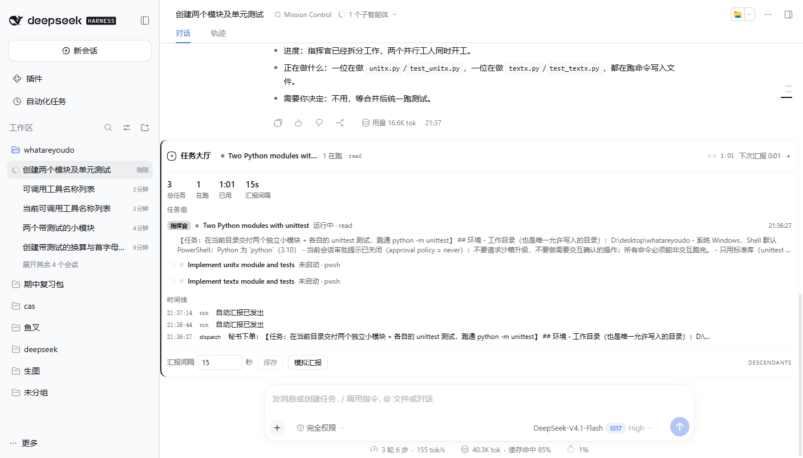
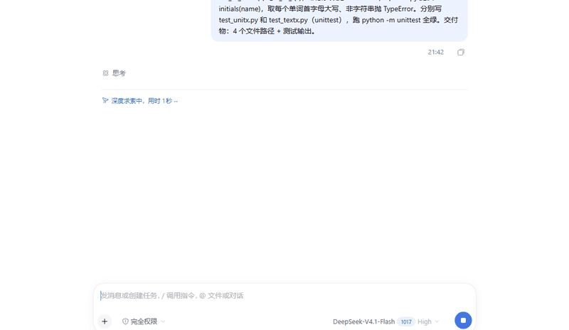
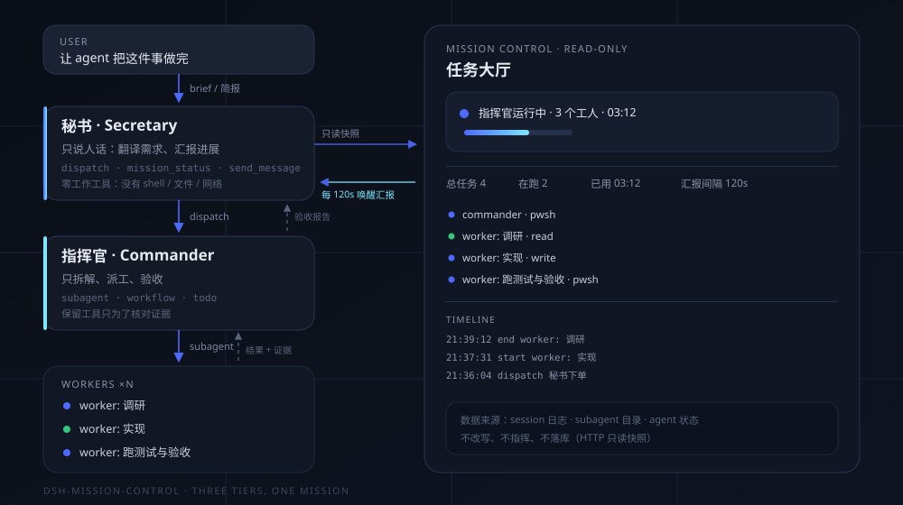

# dsh-mission-control

<p align="center">
  
</p>

<p align="center">
  <b>别让一个 agent 同时负责陪你说话和埋头干活。</b><br />
  秘书只动嘴，指挥官只调度，工人负责交付。<br />
  输入框上方一块实时任务大厅，默认每 2 分钟自动汇报一次。
</p>

<p align="center">
  <a href="README.md">English</a> ·
  <a href="#安装">安装</a> ·
  <a href="#怎么用">怎么用</a> ·
  <a href="#它是怎么跑起来的">原理</a> ·
  <a href="#配置">配置</a>
</p>



<p align="center"><sub>真实运行截图：指挥官、两个并行工人、用时，以及时间线里两次自动汇报。</sub></p>

<p align="center"></p>

<p align="center"><sub>真实任务的延时录屏：秘书下单、指挥官拉起两个并行工人、第一次自动汇报到达。</sub></p>

---

## 它解决什么问题

一个 agent 既陪你聊天又埋头写代码，任务一长就会出三种毛病：

1. **失联。** 十分钟工具调用，你完全不知道它在干活、卡住、还是跑偏了。
2. **跑题。** 上下文被工具输出塞满，你最初要的东西变成了它顺手在做的东西。
3. **没人验收。** 写代码的 agent 自己宣布「做完了」。

`dsh-mission-control` 把活拆成三个**无法悄悄合并**的角色：

- **秘书**：你只和它说话。它没有 shell、没有文件、没有网络，只负责把你的话
  变成一份自包含的简报交给指挥官，再把进展讲成人话。
- **指挥官**：只拆解、派工、验收。它保留工作工具是为了**核对证据**（读 diff、
  跑测试），但人设明令禁止它亲自实现。
- **工人**：每人只做一件有边界的事，交付可验证的结果；工人不能再派工人，树不会
  无限繁殖。

另外还有：

- **任务大厅**：显示指挥官状态、每个工人、当前在跑的工具、用时、时间线、汇报节奏。
- **每 2 分钟一次的进展汇报**（15 秒 – 1 小时可调）。秘书收到 `[[MISSION_TICK]]`
  后被唤醒，**只读**看一眼任务树，最多四行讲完；没变化就一行「无变化」。

## 安装

需要 DeepSeek Harness（`desktop` 或任意 Web profile）。

### 从 GitHub 安装

```bash
dsh plugin --profile desktop add "github:fuxiaoji/dsh-mission-control"
```

### 从本地目录安装

```bash
git clone https://github.com/fuxiaoji/dsh-mission-control
dsh plugin --profile desktop add "link:/绝对路径/dsh-mission-control"
```

### 或者在 Harness 里装

用 `plugin_manager` 工具（或 **设置 → 插件 → 安装 bundle**），目标填本仓库的绝对路径。

装完之后：

1. **刷新一次网页**，让客户端 bundle 生效。
2. **新建会话**，预设选 **Mission Control**（任务大厅）。
3. 把你想做的事说出来。

> 预设列表里还会出现 `Commander` 和 `Worker`。它们是内部角色，由秘书和指挥官
> 自动拉起，正常会话不要选。

## 怎么用

像对一位靠谱的幕僚长说话就行：

```
做一个把 Markdown 文件夹编译成静态站的 CLI。
要求：增量构建、watch 模式、有测试。
验收：npm test 全绿，examples/ 里有一个能跑的 demo。
```

秘书会先把【目标 / 交付物 / 验收标准】复述一遍，然后调用 `dispatch` 下单，并
告诉你开始定期汇报。接下来：

- **任务大厅**告诉你此刻谁在做什么。
- 每 **2 分钟**，秘书给你四行进展。
- 中途改主意，直接跟秘书说——它会用 `send_message` 把补充要求转给指挥官，而不是
  推倒重来。
- 任务结束时，秘书给你一份**验收清单**：做了什么、东西在哪、怎么验证、还剩什么风险。

常用说法：

| 你说 | 会发生什么 |
|---|---|
| 「现在到哪一步了？」 | 秘书调用 `mission_status`，照着任务树回答。 |
| 「先别写代码，给我方案」 | 简报更新，指挥官被要求停在方案阶段。 |
| 「把汇报改成 5 分钟」 | 间隔立即保存并重新计时。 |
| 「这个工人跑偏了」 | 秘书转告指挥官，由指挥官重新收窄任务边界。 |

## 它是怎么跑起来的



### 三个预设

| 预设 | id | 谁拉起 | 工具 | 职责 |
|---|---|---|---|---|
| **Mission Control** | `orchestrator` | 你 | `dispatch`、`mission_status`、`send_message`、`list_agents`、`ask_user_question`、`present` | 翻译、汇报、传话；永远不干活。 |
| **Commander** | `commander` | 秘书的 `dispatch` | shell、文件、搜索、web、todo、`subagent`、`workflow` | 拆解、派工、验收、汇总。 |
| **Worker** | `worker` | 指挥官的 `subagent` | shell、文件、搜索、web、todo | 一件事，一个可验证结果。 |

在 DSH 里，预设就是完整的能力边界。所以「秘书永远不干活」不是一句提示词请求——
那个会话里根本没有可用的干活工具。

### 一次任务的流转

```
用户 ──▶ 秘书 ──dispatch(简报)──▶ 指挥官 ──subagent──▶ 工人
           ▲                        │                    │
           │                        └────── 结果/证据 ────┘
           │                              （验收）
           └────────── 验收报告 ──────────┘
```

1. 秘书写简报（目标、交付物、验收标准、约束、不能碰什么），调用 `dispatch`。
2. `dispatch` 就是一个钉死 `commander` 预设的官方 `dsh-tool-subagent`。子会话在
   后台启动，工具立刻返回，秘书可以继续和你说话。
3. 指挥官写 todo 计划，能并行就一次发多个工人。
4. 工人回报，指挥官核对证据（文件、diff、测试输出），不合格打回重做。
5. 指挥官给结构化总结，秘书翻译成给你的验收清单。
6. 与此同时，Host 插件每 N 秒用**只读快照**唤醒秘书一次——不干活、不产生副作用。

### 装了哪些东西

| 部分 | 文件 | 作用 |
|---|---|---|
| Host 插件 | `index.js` | 任务登记、`mission_status` 工具、汇报定时器、只读 `/dsh-mission/api/*`。 |
| 客户端插件 | `client.js` | `conversation.input.dock` 里的任务大厅，每 2.5 秒拉一次快照。 |
| 预设 | `cordis.patch.yml` | 声明 `orchestrator`、`commander`、`worker`。 |
| 纯函数 | `lib/pure.js` | 配置归一化、任务树整形，可脱离 Harness 单测。 |

Host 插件里**没有一行创建 agent 的代码**：子会话的创建、深度限制、取消、清理、
权限全部留在 DSH 手里；插件只观察 `subagent` 目录并汇报。

## 配置

配置写在插件行上，升级不会丢：

```yaml
- id: mission-control
  name: dsh-mission-control
  config:
    reportIntervalSec: 120     # 15–3600，多久汇报一次
    secretaryPresets: [orchestrator]
    commanderPresets: [commander]
    denyCommanderWrites: true  # 禁止指挥官 write/edit
    dispatchToolName: dispatch
    idleStopMinutes: 20        # 整棵树空闲多久后停止汇报
    maxEvents: 40              # 每个任务保留的时间线条数
    minTickGapSec: 30          # 防止 tick 堆积
```

改 `$DSH_HOME/profiles/<profile>/cordis.patch.yml` 即可；也可以在大厅底部直接改
汇报间隔（会写进 `$DSH_HOME/mission-control/state.json`）。

想让指挥官用更强的模型，给 `dispatch` 单独指定路由：

```yaml
- id: dispatch
  name: '@deepseek-ai/dsh-tool-subagent'
  config:
    provider: spawn
    toolName: dispatch
    agentPreset: commander
    maxDepth: 3
    agentOptions:
      provider: deepseek-official
      model: deepseek-reasoner
```

## 设计取舍

**为什么秘书一个干活工具都不给。** 靠提示词说「你别动手」，遇到看起来一行就能
搞定的任务一定失效。删掉工具是可执行、可见（schema 里就没有）、并且能扛住上下文
压缩的约束——秘书**物理上**跑不了 `bash`。

**为什么指挥官保留工具。** 验收要证据：读 diff、跑测试、确认文件真的存在。指挥官
被允许**检查**，Host 插件会给每个指挥官装一个工具守卫，**禁止 `write` / `edit`**——
提示词说「派工」，守卫让它变成真的；shell 保留，因为跑测试属于验收。

**为什么工人不能再派工。** 无界递归是 2 块钱的任务变成 40 块钱的原因。工人只有一个
任务、没有 `subagent` 工具；扇出由指挥官统一负责。

**为什么定时用 `followup` 而不是 `inject`。** `inject` 不会唤醒空闲 agent，汇报就
只能等你下次说话才出现。`followup` 会唤醒秘书；插件在秘书已经在跑时跳过本次 tick，
整棵树空闲一分钟后彻底停止。

**为什么任务大厅读 session 目录。** 任务状态直接来自 `subagent` 目录和 live agent
状态，不另建一套数据库。刷新页面、重启 Harness、甚至冷会话恢复，看到的都是真实的树。

## 权限与成本

- **权限**：in-process 子会话继承发起会话的权限范围，而且**不能弹审批**——需要审批
  的操作会被直接拒绝。跑任务时请把会话权限切到 **Auto** 或 **Full access**，否则
  工人会在第一次写文件时卡住。
- **成本**：每次 tick 是一次很小的模型调用（读一次任务树，写四行）。默认 120 秒
  就是每小时 30 次；整棵树空闲后自动停，任务结束不再花钱。
- **深度**：预设里 `maxDepth: 3`，Harness 默认 `maxActiveSubagents: 8`，即一个
  指挥官最多同时带 8 个活着的工人。

## 已知限制

- **`mission_status` 会出现在所有 agent 的 schema 里。** 它注册在 Host 工具表上，
  指挥官的工人也能看到这个名字；执行时会拒绝非秘书会话的调用。目前 Harness 的
  插件 API 没有提供「按预设隐藏 Host 工具」的能力。
- **预设按会话固定。** 改完提示词要新建会话才生效；已有会话保留启动时的版本。
- **任务大厅是轮询。** 每 2.5 秒拉一次只读快照，不是 websocket 推送。
- **秘书可能把一个请求拆成两份简报。** 提示词里要求它别拆，但如果用户明确说了
  两件互不相干的交付物，仍可能出现两个指挥官；面板会按任务组分别展示。

## 排障

| 现象 | 原因 / 处理 |
|---|---|
| 预设列表里没有 **Mission Control** | bundle 没启用，或页面没刷新。刷新后看 **设置 → 插件**。 |
| 任务大厅一直不出现 | 客户端 bundle 还没加载。安装后强制刷新一次页面。 |
| `dispatch` 报预设错误 | `commander` 预设没激活，看插件行里的诊断。 |
| 工人卡在审批 | 会话是「询问」模式。切到 Auto/Full，重新发起任务。 |
| 没有汇报 | 检查 `reportIntervalSec`、会话是否空闲、任务是否有活着的子会话。 |
| 汇报太吵 | 调大 `reportIntervalSec`，或调小 `idleStopMinutes`。 |

## 开发

```bash
node --test            # 纯函数测试，不需要 Harness
node --check index.js  # Host 半边
node --check client.js # 客户端半边
```

仓库刻意零依赖：两个普通 ES module、一份 YAML patch、一个图标、两份 locale。没有
构建步骤。

```
.
├── index.js            Host 插件
├── client.js           Web 客户端插件
├── cordis.patch.yml    bundle patch + 三个预设
├── lib/pure.js         可单测的纯函数
├── tests/              node:test 用例
├── locale/             插件元数据（中/英）
└── docs/               架构图与预览素材
```

## License

MIT，见 [LICENSE](LICENSE)。
